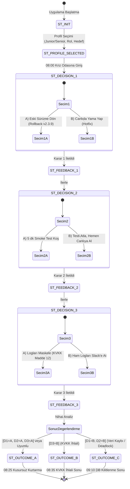

# DESIGN.md - "SE Primer" Vibe & UI Design Standartları

Bu doküman, Google Stitch tasarım yaklaşımı ve mobil öncelikli kullanıcı arayüzü (UI/UX) standartlarını tanımlar.

---

## 1. Tasarım Teması ve Hissi (Vibe & Aesthetics)

* **Tema Adı:** *Mission Critical Incident Control (Kriz Odası)*
* **Duygu:** Yüksek odak, ciddiyet, teknik derinlik, aciliyet ancak kontrollü bir sakinlik.
* **Tasarım Dili:** Terminal ve modern sağlık izleme dashboard'larının birleşimi. Kart tabanlı, dokunmatik dostu, net kontrastlı ve dikkat dağıtmayan minimalist mobil düzen.

---

## 2. Renk Paleti (Color Tokens)

| Renk Kodu | Rol | Kullanım Alanı |
| :--- | :--- | :--- |
| `#0F172A` (Slate 900) | **Arka Plan (Primary)** | Ana zemin, kriz odası karanlık modu |
| `#1E293B` (Slate 800) | **Kart / Panel Yüzeyi** | Karar kartları, diyalog pencereleri |
| `#38BDF8` (Sky 400) | **Vurgu (Accent / Tutor)** | Sokratik AI Tutor mesajları, interaktif butonlar |
| `#EF4444` (Red 500) | **Kriz / Uyarı (Critical)** | Hata logları, 500 hataları, KVKK ihlalleri |
| `#10B981` (Emerald 500) | **Başarı (Success)** | Kurtarılan metrikler, onaylanan smoke testler |
| `#F59E0B` (Amber 500) | **Gecikme / Risk** | Zaman baskısı sayacı, veri tabanı uyuşmazlıkları |
| `#F8FAFC` (Slate 50) | **Metin (Foreground)** | Okunabilir ana metinler ve başlıklar |

---

## 3. Tipografi ve İkonografi

* **Gövde Metni:** `Inter` veya sistem yazı tipi (`sans-serif`), 15px - 16px, 1.5 line-height (mobil ergonomisi).
* **Teknik & Kod Blokları:** `JetBrains Mono` veya `monospace`, 13px (loglar, HTTP kodları, DB sorguları).
* **Başlıklar:** Kalın (Semi-bold / Bold), hiyerarşik h1-h3 yapısı.

---

## 4. 3 Temel Mobil Ekran Yapısı (Wireframe Spesifikasyonları)

### Ekran 1: Giriş ve Profil Seçimi (`/profile`)
* **Üst Bar:** "SE Primer: Yazılım Mühendisliği Simülasyonu" başlığı ve küçük acil durum amblemi.
* **Kriz Ön Özeti:** "Pazartesi 08:00 - Randevu Sistemi Çöktü" özet kartı.
* **3 Seçim Alanı:**
  1. *Deneyim:* [Yeni Başlayan (Junior) / Deneyimli (Senior)]
  2. *Rol:* [Backend Mühendisi / DevOps - SRE]
  3. *Öncelik:* [Hızlı Kurtarma / Veri & Hukuk Güvenliği]
* **Aksiyon:** "Kriz Odasına Gir" (Pulsing primary button).

### Ekran 2: Sahne ve Karar Ekranı (`/simulation`)
* **Durum Çubuğu (Status Bar):** 
  - Saat: `08:05 AM` (Kararlarla ilerler)
  - Bekleyen Hasta: `320 Kişi`
  - Geri sayım (Eğer Senior seçildiyse: `00:45 sn`).
* **Terminal & Olay Akışı:** Canlı log penceresi (`HTTP 500 - HikariPool connection timeout`).
* **Sokratik AI Tutor Bölümü:**
  - Avatar: "AI Mentor"
  - Mesaj baloncuğu: Sokratik ipucu veya soru.
  - "Akıl Danış" butonu (Junior için açık, Senior için opsiyonel).
* **Karar Seçenekleri:** 2 belirgin kart (`A Şıkkı` ve `B Şıkkı`). Her kartın üzerinde teknik özet.
* **Seçim Sonrası Anlık Geri Bildirim Modal/Drawer:** Ne oldu, sistem nasıl tepki verdi, teknik sebebi ne?

### Ekran 3: Sonuç ve Değerlendirme Ekranı (`/outcome`)
* **Büyük Durum Rozeti:** 
  - Yeşil: "Kusursuz Kurtarma (08:25)"
  - Sarı/Kırmızı: "Sistem Ayakta Fakat KVKK Cezası (08:35)"
  - Kırmızı: "Kritik Veri Kaybı ve Kilitlenme (09:10)"
* **Skor ve Metrikler Tablosu:**
  - MTTR (Çözüm Süresi): 25 dk
  - Veri Kaybı: %0
  - KVKK Risk Skoru: Güvenli
* **Mimari Retrospektif:** Verilen 3 kararın mimari analizi (Sommerville & AI-DLC prensipleri referanslı).
* **Tekrar Oyna / Farklı Yolu Dene:** Buton.

---

## 5. Durum Makinesi Geçiş Matrisi

| Mevcut Durum | Tetikleyici Seçim | Yeni Durum | Teknik Neden |
| :--- | :--- | :--- | :--- |
| `ST_INIT` | Profil Onayı | `ST_CRISIS_START` | Kullanıcı profili sisteme yüklendi |
| `ST_CRISIS_START` | Devam Et | `ST_DECISION_1` | 08:00 Arıza tespit edildi |
| `ST_DECISION_1` | `1A (Rollback)` | `ST_DECISION_2` | v2.3.9'a geri dönüldü, DB migration riski aktif |
| `ST_DECISION_1` | `1B (Hotfix)` | `ST_DECISION_2` | Canlıda yama yapıldı, yan etki riski aktif |
| `ST_DECISION_2` | `2A (Smoke Test)` | `ST_DECISION_3` | 5 dk test koşuldu, regresyon önlendi |
| `ST_DECISION_2` | `2B (Doğrudan Prod)`| `ST_DECISION_3` | Test atlandı, gizli deadlock riski prod'a sızdı |
| `ST_DECISION_3` | `3A (Maskele)` | `ST_OUTCOME_SUCCESS` | KVKK Madde 12 korundu |
| `ST_DECISION_3` | `3B (Ham Log At)` | `ST_OUTCOME_KVKK_FAIL`| Slack'e sızan sağlık verisi ihlali doğurdu |

---

## 6. Durum Makinesi Diyagramı (Mermaid State Diagram)



---

## 7. Stitch Mobil Ekran Düzenleri (Screen Wireframes)

```
+-----------------------------------+  +-----------------------------------+  +-----------------------------------+
|  [!] SE PRIMER · 08:00            |  |  [!] SE PRIMER · 08:15            |  |  [!] SE PRIMER · 08:25            |
+-----------------------------------+  +-----------------------------------+  +-----------------------------------+
|  08:00 Randevu Sistemi Çöktü      |  |  [⏱️ KRİZ SÜRE BASKISI: 45s]      |  |             🏆 08:25              |
|                                   |  |  +-------------------------------+|  |         Kusursuz Kurtarma         |
|  1. Deneyim Seviyen:              |  |  | stdout: connection timeout    ||  |                                   |
|  [ Junior (Açık) ] [ Senior (60s)]|  |  +-------------------------------+|  |  Kriz Karnesi:                    |
|                                   |  |  Karar 2: Test Stratejisi         |  |  - MTTR: 25 Dakika                |
|  2. Rol:                          |  |                                   |  |  - Veri Tutarlılığı: %100 Güvenli |
|  [ Backend ]       [ DevOps/SRE ] |  |  🤖 Sokratik Mentor:              |  |  - KVKK Durumu: Tam Uyumlu        |
|                                   |  |  "Testi atlarsan kazanacağın 5 dk |  |                                   |
|  3. Öncelik:                      |  |   sessiz veri bozulmasına değer   |  |  📐 Mühendislik Çıkarımı:        |
|  [ Hızlı Kurtarma] [ Veri Güveni] |  |   mi?"                            |  |  Arayüz sözleşmeleri ve smoke     |
|                                   |  |  [💬 Mentor'a Soru Sor]           |  |  testlerle regresyon önlendi.     |
|  +-------------------------------+|  |                                   |  |                                   |
|  |     KRİZ ODASINA GİR ->       ||  |  [ A) 5 dk Smoke Test Koş       ] |  |  +-------------------------------+|
|  +-------------------------------+|  |  [ B) Hemen Canlıya Al          ] |  |  |    Yeniden Başlat (Farklı Yol)|
+-----------------------------------+  +-----------------------------------+  +-----------------------------------+
      (Ekran 1: Profil Seçimi)              (Ekran 2: Sahne & Karar)               (Ekran 3: Nihai Sonuç)
```

