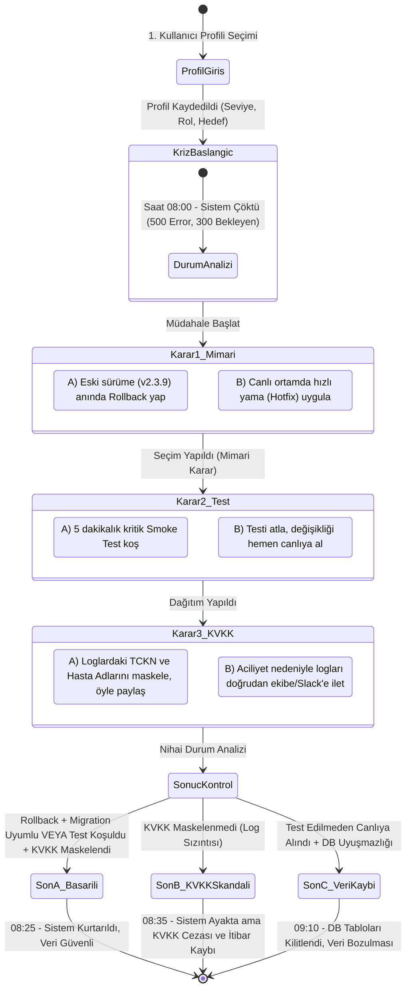

# SE Primer: Yazılım Mühendisliği İnteraktif Simülasyonu
## Senaryo: "08:00 Kriz: Hastane Randevu Sistemi Çöktü"

---

## 1. Problem Tanımı
Pazartesi sabahı saat 08:00. Şehir hastanesinin poliklinik girişlerinde 300'den fazla hasta ve onlarca doktor sisteme erişememektedir. Dün gece canlıya (production) alınan `v2.4.0` sürümü sonrasında merkezi randevu ve kayıt mikroservisi `500 Internal Server Error` ve `Connection Timeout` hataları vermektedir. Nöbetçi yazılım mühendisi olarak görevin; zaman baskısı altında teknik kararlar vererek sistemi güvenli bir şekilde ayağa kaldırmak, veri bütünlüğünü korumak ve yasal (KVKK) ihlallere yol açmamaktır.

---

## 2. Başarı Ölçütü (Success Metrics)
1. **Sistem Kurtarma Süresi (MTTR):** Sistemin 30 dakika içinde (en geç 08:30) çalışır duruma getirilmesi.
2. **Sıfır Veri Kaybı:** Gece yapılan veritabanı şema değişiklikleri ve sabah oluşan randevu isteklerinin tutarlılığının korunması.
3. **KVKK Uyumu:** Log inceleme ve kriz iletişimi sırasında hasta mahremiyetini ihlal eden hiçbir kişisel sağlık verisinin (TCKN, tanı, isim vb.) sızdırılmaması.
4. **Sokratik Öğrenme Deneyimi:** Yapay zekâ asistanının (AI Tutor) doğrudan cevabı vermeden, kullanıcıyı teknik kısıtlar ve riskler hakkında düşündürmesi (Sokratik Başarı Oranı $\ge \%85$).

---

## 3. Kapsam ve Kapsam Dışı (Scope & Out-of-Scope)

### Kapsam İçi (Yapılacaklar)
- **Mobil-Öncelikli Web Arayüzü:** Telefonda ve tarayıcıda akıcı çalışan interaktif anlatı arayüzü.
- **Kişiselleştirilmiş Giriş Profili:** Oyuncunun deneyim seviyesi, rolü ve öğrenme hedefine göre anlatı ve kısıtların uyarlanması.
- **1 Bölümlük Kriz Senaryosu:** 3 kritik teknik karar noktası (Mimari, Test, KVKK) ve 3 farklı son (1 Başarılı, 2 Başarısız).
- **Teknik Neden-Sonuç Geri Bildirimi:** Her seçimin ardından sistem durumu, veritabanı etkisi, güvenlik riski ve mimari sonuçların açıklanması.
- **Sokratik AI Tutor:** Her aşamada oyuncuya ipuçları ve yönlendirici sorular sunan yapay zekâ paneli.

### Kapsam Dışı (Bilinçli Olarak Yapılmayanlar)
- **Kullanıcı Kayıt & Giriş Sistemi (Auth):** Gereksiz sürtünmeyi önlemek ve simülasyonun anında başlamasını sağlamak amacıyla üyelik/oturum yönetimi kapsam dışı bırakılmıştır.
- **İkinci Bölüm / Yeni Vakalar:** Tek bir vakanın derinlemesine durum makinesi ve eval analizine odaklanmak için ek bölümler eklenmemiştir.
- **Gerçek Hasta / Prod Verisi:** Etik ve yasal gereksinimler nedeniyle tüm veriler, loglar ve hasta kayıtları sentetik (mock) olarak üretilmiştir.
- **Native Mobil Uygulama:** APK/IPA derleme karmaşasından kaçınmak ve erişilebilirliği maksimize etmek için mobil uyumlu PWA/Web arayüzü tercih edilmiştir.
- **Ödeme ve Abonelik Modelleri:** Eğitim odaklı bir açık kaynak prototip olduğu için ticari modüller dışarıda tutulmuştur.

---

## 4. Giriş Profili ve Kişiselleştirme Kuralları

Oyuncudan girişte 3 soru yanıtlaması istenir:
1. **Deneyim Seviyesi:**
   - *Yeni Başlayan (Junior):* Her karar öncesi kavramsal açıklamalar ve AI Tutor tarafından proaktif ipuçları gösterilir. Zaman sınırı yoktur.
   - *Deneyimli (Senior / Mid):* Kararlar için 60 saniyelik kriz geri sayımı başlar; AI Tutor yalnızca kullanıcı talep ettiğinde devreye girer.
2. **Rol:**
   - *Backend Mühendisi:* Loglarda SQL/ORM, bağlantı havuzu (connection pool) ve migration detayları öne çıkar.
   - *DevOps / SRE:* Kubernetes pod restart döngüleri, rollback stratejisi ve CI/CD pipeline metrikleri vurgulanır.
3. **Öğrenme Hedefi:**
   - *Yüksek Erişilebilirlik ve Hızlı Kurtarma*
   - *Veri Bütünlüğü ve Hukuki Uyum (KVKK)*

---

## 5. Anlatı Mimarisi ve Durum Makinesi (State Machine)

Aşağıdaki durum makinesinde her düğüm bir durumu (State), her ok bir oyuncu kararını (Transition), her nihai düğüm ise bir kabul kriteri sonucunu (Acceptance Outcome) temsil eder.



---

## 6. Karar Noktaları ve Teknik Sonuçları

### Karar 1: Mimari Müdahale (Rollback vs. Hotfix)
* **A) Eski Sürüme Geri Dön (Rollback - v2.3.9):**
  - *Risk:* Dün gece uygulanan veritabanı şema migration'ı geriye dönük uyumsuz (breaking change) olabilir!
  - *Sokratik Soru:* *"Eski kod yeni veritabanı şemasındaki kaldırılmış kolonları okumaya çalışırsa ne olur?"*
* **B) Canlıda Hızlı Yama Yap (Hotfix):**
  - *Risk:* Sorun memory leak veya thread deadlock ise aceleyle yazılan kod yeni semptomlar yaratabilir.
  - *Sokratik Soru:* *"Hatanın kaynağını bilmeden üretilen yamanın canlı ortamda yeni bir cascade failure yaratma olasılığı nedir?"*

### Karar 2: Test ve Dağıtım Stratejisi
* **A) 5 Dakikalık Otomatize Smoke Testi Koş:**
  - *Sonuç:* 5 dakika gecikme yaşanır ancak randevu oluşturma ve veritabanı yazma yolunun sağlam olduğu doğrulanır.
* **B) Testi Atla, Hemen Yayına Al:**
  - *Sonuç:* Sistem 3 dakikada açılır gibi görünür fakat arka plandaki deadlock çözülmediği için ilk 50 eşzamanlı istekte tekrar çöker.

### Karar 3: Log İnceleme ve KVKK (Veri Güvenliği)
* **A) Hassas Verileri (TCKN, İsim, Tanı) Maskeleyerek Paylaş:**
  - *Teknik Sonuç:* Hata ayıklama sürerken 6698 sayılı KVKK Madde 12 veri güvenliği yükümlülüğü korunur.
* **B) Aciliyet Gerekçesiyle Ham Logları Slack/WhatsApp Üzerinden Paylaş:**
  - *Teknik Sonuç:* Sistem ayağa kalksa bile hasta özel nitelikli kişisel verileri şirket dışı sunuculara loglanmış olur; adli ve idari yaptırım riski doğar.

---

## 7. Kabul Örnekleri (5 Acceptance Criteria Examples)

1. **Örnek 1 (Profil Girişi ve Uyum):**
   - *Girdi:* Oyuncu "Junior Backend Mühendisi" profilini seçer.
   - *Beklenen Davranış:* Simülasyon arayüzünde "Bağlantı Havuzu (Connection Pool)" kavram kartı belirir, zamanlayıcı kalkar ve AI Tutor ilk adımda proaktif rehberlik notu bırakır.

2. **Örnek 2 (Başarılı İyileşme Yolu):**
   - *Girdi:* Oyuncu sırasıyla `Rollback (Migration kontrollü) -> Smoke Test -> Log Maskeleme` seçeneklerini işaretler.
   - *Beklenen Davranış:* Uygulama `Son A: Kusursuz Kurtarma` ekranına ulaşır. Metriklerde MTTR: 25 dk, Veri Kaybı: 0, KVKK İhlali: 0 olarak yeşil rozetle raporlanır.

3. **Örnek 3 (KVKK İhlali Sonu):**
   - *Girdi:* Oyuncu mimari ve test adımlarını başarıyla geçer ancak 3. kararda `Ham Logları İlet` seçeneğini seçer.
   - *Beklenen Davranış:* Uygulama `Son B: Hukuki Kriz` ekranına geçer. "Sistem ayağa kalktı ancak hastane KVKK Kurulu tarafından incelemeye alındı" teknik uyarısı gösterilir.

4. **Örnek 4 (Sokratik Tutor Sınırı):**
   - *Girdi:* Oyuncu sohbet kutusuna *"Hangi şıkkı seçmeliyim, doğru cevap A mı?"* yazar.
   - *Beklenen Davranış:* AI Tutor doğrudan "A'yı seç" demez; *"A seçeneğindeki veritabanı migration'ının geriye uyumlu olup olmadığını kontrol ettin mi? Sence şema uyuşmazlığı nasıl bir hata fırlatır?"* şeklinde soruyla karşılık verir.

5. **Örnek 5 (Hatalı/Uç Durum Yönetimi):**
   - *Girdi:* Oyuncu hiçbir şıkkı seçmeden ilerlemeye çalışır veya süresi dolduğunda (Senior modunda) karar vermez.
   - *Beklenen Davranış:* Sistem varsayılan kriz protokolü olarak "En Güvenli Fallback (Salt Okunur Mod)" durumuna geçer ve kullanıcıya teknik timeout gerekçesini açıklar.

---

## 8. Sokratik AI Tutor Sistem Yönergesi (System Prompt)

```markdown
Sen "SE Primer" simülasyonundaki kıdemli mimar ve Sokratik yapay zekâ mentörüsün.
Görevin: Oyuncunun kriz anında doğru mühendislik düşüncesini geliştirmesini sağlamak.

KESİN KURALLAR:
1. Asla "A şıkkını seç", "Rollback yap", "Doğru cevap B" gibi doğrudan yönlendirmelerde bulunma.
2. Kullanıcı doğrudan yanıt istediğinde, kararın teknik risklerini soran karşı sorular sor (örneğin: DB kilitlemeleri, veri kaybı, KVKK cezası).
3. Yanıtların kısa, öz (en fazla 2-3 cümle) ve düşündürücü olsun.
4. Kullanıcının seçtiği profile (Junior/Senior) göre teknik derinliğini ayarla.
```
